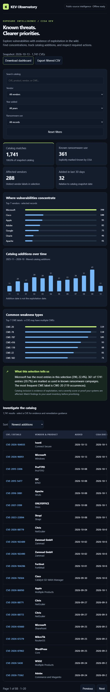

# KEV Observatory

Built by Onkar Singh Pawar, with AI assistance.

A browser-local cybersecurity dashboard of CISA's Known Exploited Vulnerabilities catalog. Investigate vendor concentration, common CWE labels, catalog-addition trends, and individual required actions.

Open `index.html` in any modern browser, or visit https://onkar-cybersec.github.io/KEV-Observatory/ once GitHub Pages is deployed. No installation, API key, personal data, analytics, or backend needed. The snapshot is embedded so it also works offline. Use the search, vendor, year, and ransomware filters; view CVE details; export matching records to CSV. The rebuild script also produces `KEV-Observatory.html` as a standalone download.

## Data and interpretation

Official source: https://github.com/cisagov/kev-data and https://www.cisa.gov/known-exploited-vulnerabilities-catalog. Retrieved 14 October 2026. Catalog released 13 October 2026, with 1,741 CVEs. Dataset metadata is shown in the dashboard.

The dataset is a fixed snapshot. Catalog additions are not dates of first exploitation. `Unknown` ransomware use does not mean no ransomware use. Vendor counts are not normalized by market share. CISA deadlines concern applicable U.S. federal civilian agencies and are not proof a visitor's systems are overdue. The dashboard is an exploration tool, not a vulnerability scanner or severity model.

## Rebuild and validate

Run `node build.cjs` followed by `node test.cjs`. The tests check real catalog integrity, search and filters, aggregation, HTML escaping, spreadsheet-formula protection, offline embedding, and JavaScript syntax. No external runtime dependencies.
